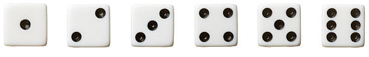
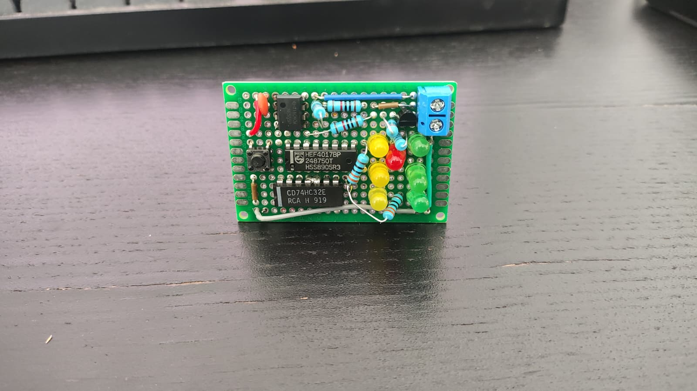
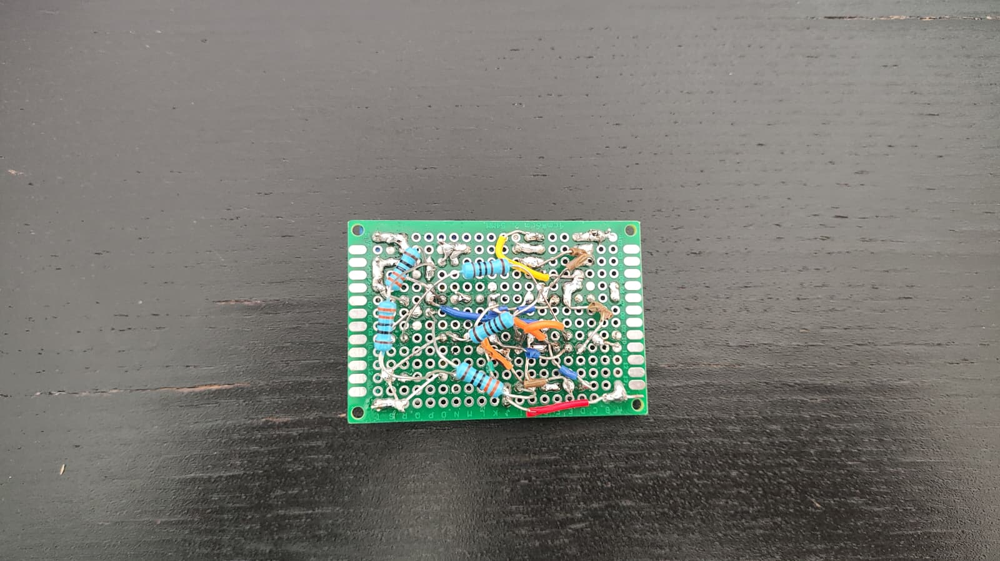

# Electric dice

This is my first electronic project, it was inspired by this video (https://www.youtube.com/watch?v=EbNv-qJeaCI). 
I follow most of his premise, but use it to create the schema, the PCB and a functional prototype. 

## Objective
Create a virtual 6 faces dice.
When push the button, it fire the clock to send an astable signal to the IC counter from 1 to 7 (the 7 it will restar the counter).

It can handle the 6 posible state, only managmente 4 groups of leds.

```
*2     *5 
*3  *1 *6
*4     *7
```

- The led 1 it will be ON to reresent the numbers 1, 3 and 5.
- The led 4 and 5 it will be always ON excepto when need to represent the number 1.
- The led 2 and 7 it will be ON to reresent the numbers 4, 5 and 6.
- The led 3 and 6 it will be ON to reresent the numbers 6.


 

## First step (Schema)
Learn how to use KICad and how to make a schema, and some of good practice/convention to do it.
I had to re do a cuple of time to improve the readability of it, in the first version the lines are all over the place.

## Second step (Prototype)  

Learn to solder and use bigger PCB board next time. 
Using this small PCB to following the conection from on leg to another was a nighmare, and have no room to add the resitance in his respective holes.  




## Therd step (PCB)

Keep learning KiCad and how to use the PCB Editor, managment the footprint of the diferente components  